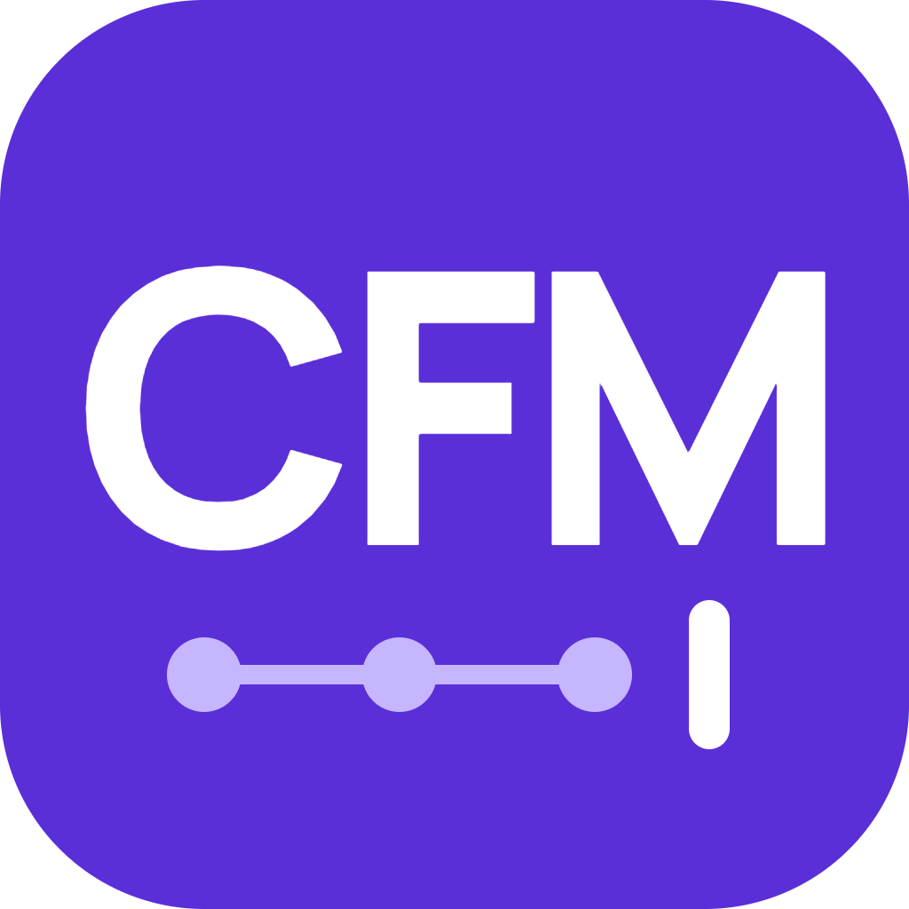

<p align="center">
  
</p>

# cfm: Code For Me

[](.claude-plugin/plugin.json)
[](#license)
[](https://code.claude.com)

**[Documentation](#install-in-30-seconds)** · **[Commands](#commands)** · **[Privacy](PRIVACY.md)** · **[Connectors](CONNECTORS.md)** · **[License](#license)**

**A supervised, multi-agent development workflow for Claude Code, where the orchestrator never writes code, every phase ends at a gate only you can cross, and every rule that matters is written down once and checked by a doctor.**

cfm is for engineers who want agents to do the typing without giving up the review. One file, `.cfm-workflow.yml`, drives everything: skills, agents, and the reference procedures read it at runtime instead of duplicating knowledge into prose. A `doctor` keeps that config and your repository honest with each other: config values are promises; the doctor converts them to facts.

The plugin ships no executable code. It is Markdown, JSON, YAML, and one icon: every procedure cfm used to run as a script is now a reference document Claude follows step by step, and every enforcement it relies on is one Claude Code already provides: permission deny rules in your project's `settings.json`, tool limits in each agent's file, and the doctrine rendered into your `CLAUDE.md`.

> **Requires Claude Code.** cfm runs in the terminal CLI, the IDE extensions, or the Desktop app's Code tab. It does not run in Cowork or Chat, and every command checks that first.

## Install in 30 seconds

**Step 1.** Install **Code For Me** from the Claude plugin directory, or add it from any Claude Code session:

```
/plugin marketplace add rokib572/code-for-me-cfm
/plugin install cfm@code-for-me-cfm
```

Every `/cfm:*` command is available from the next prompt, and updates arrive through the plugin manager. Not sure where to begin? `/cfm:help` explains where to start and lists every command.

**Step 2.** Open the project you want agents to work in and run `/cfm:init`. It detects your scenario (empty directory, existing repo, scaffolded repo, or a prior `.claude/` setup to adopt), interviews you, writes the config, scaffolds the workflow files, writes the settings denies, and runs the doctor until it is green.

**Step 3.** `/cfm:plan` a feature, `/cfm:implement-phase` a phase, cross the gate. That is the whole loop.

## The golden path

From an empty directory to shipped, reviewed code.

### 1. Brainstorm: `/cfm:brainstorm`

Describe what you want to build. You get a guided ideation conversation: problem, personas, MVP features, non-goals, with **zero** configuration questions: no stack, no tooling, no setup. It ends in `docs/brief.md`. Stopping here costs you nothing.

### 2. Initialize: `/cfm:init`

The gate between thinking and building is deliberate: cfm never slides from a brief into code on its own. When you say you want to move to development, `/cfm:init` runs the interview, routes each architecture answer to config (if enforceable) or a short ADR (if rationale), turns every convention you pick into a numbered rule with a declared enforcement owner, **measures** each rule claimed as lint-enforced by writing a deliberate violation and watching the linter bite, dispatches the stack skeleton to the coder agent, writes the settings denies, and ends on a green doctor.

### 3. Plan a feature: `/cfm:plan`

cfm reads the actual codebase first, then writes `docs/plans/<feature-slug>.md`: independently shippable phases, each sized for one implement run, each declaring the **seams** its tests will observe behavior from. A YAGNI pass names speculative scope before you see it. The plan is presented through Claude Code's plan-mode approval gate, never an informal "looks good?".

### 4. Implement a phase: `/cfm:implement-phase`

The phase opens in plan mode with its full dispatch plan: layers in order, agents per layer with their file scopes, the gates that will run. Approve it with auto-accept edits and the phase runs unattended. The orchestrator dispatches the coder per layer, has the test agent write and run scoped tests **by explicit file path** at the declared seams, then runs the review pipeline exactly as `review_gates` declares it. A failed gate goes back to the coder with the reviewer's raw output and only that gate re-runs. Every boundary is written to the ledger as it happens, following one documented procedure, so a killed session resumes cleanly.

### 5. The phase gate: your part

cfm reports results and token usage, updates `docs/PROGRESS.md` and state, and **stops**. Then the human-only steps: run the full suite yourself (`verify_full` is contractually your command, and the generated settings denies refuse it to every agent), review the diff, do the git work your autonomy level reserves for you, and start the next phase explicitly. cfm never auto-starts one.

### 6. Keep it honest: `/cfm:doctor`, `/cfm:configure`, `/cfm:status`, `/cfm:code-review`

The doctor validates ten things, from "does every configured command run green" to "are the settings denies present, complete, and not stale from an earlier config", and it runs automatically after every config change.

Change any value through `/cfm:configure`: current value, YAML diff, explicit apply, automatic doctor. Raising the git level also retracts the settings denies the old level wrote; cfm owns the rules it generates, so a level change is never silently ineffective at the permission layer.

`/cfm:status` is a pure read of where the workflow stands, including the code-anchored debt ledger; `/cfm:code-review` runs the configured pipeline over a diff, a path, or a plain-English scope.

### 7. cfm mode: every session in the repo is an orchestrator session

Once `.cfm-workflow.yml` exists, there is no "plain" session in that repository. Claude Code's own modes (plan, auto-accept, manual) are fixed and no plugin can add one, so cfm mode is a layer on top of whichever is active. `/cfm:init` renders the **orchestrator doctrine** into your project's `CLAUDE.md`, inside a marked region cfm owns: who the orchestrator is, what counts as product code, the `/cfm:*` routing table, the human-only gates, and a start-of-session instruction to read the ledger and report the phase in flight. `CLAUDE.md` is loaded into every session and reloaded after compaction, so the doctrine survives a long session without a hook.

```yaml
mode: enforced   # enforced (default) | advisory (doctrine, softer rule) | off
```

`/cfm:mode advisory` or `/cfm:mode off` lowers it: a one-line config diff you approve, a re-render of the marked region, then the doctor. It is a team setting (the local override file cannot carry it), because "the orchestrator never writes code" is a promise the repository makes, not one developer's comfort. The doctor's check 8 verifies the mode every run: the doctrine block must be present and announce the configured mode.

What `mode` does **not** do in this edition: there is no runtime guard that refuses a main-session edit. The orchestrator-only rule is doctrine the session follows, backed by the review pipeline seeing every diff. The rules that must hold regardless of prompt wording (secrets, git level, `verify_full`) are enforced by Claude Code's permission layer, not by prose: see [Guardrails and security](#guardrails-and-security).

## Why cfm exists

Agents write plausible code quickly. The failure modes are not in the typing; they are in what nobody checked, what quietly drifted, and what was promised in a paragraph nobody enforced. cfm exists to make four things mechanical.

### #1 A rule that lives only in prose is a wish

> "I will contend that conceptual integrity is the most important consideration in system design."
> Fred Brooks, *The Mythical Man-Month*

**The Problem.** Workflow setups accumulate CLAUDE.md paragraphs, agent instructions, and settings that all describe the same policy slightly differently. Six months in, the config says one thing, the agent file says another, and the linter that "enforces" the naming rule has no rule configured. Nothing fails; everything drifts.

**The Fix.** One file is the source of truth, and the doctor converts its promises to facts. Every configured command is executed to prove it green. Every rule must declare its enforcement owner, and a rule claimed as lint-enforced is **measured** at init: the coder writes a deliberate violation and the mechanical-gate runs your linter against it. A rule that fails to bite is wired into the linter or demoted to a reviewer; an unproven claim never survives. The doctor fails when an agent file grants more than the config admits, when a settings deny is missing **or stale**, when the ledger is malformed.

### #2 The one who writes the code should not be the one who judges it

> "Program testing can be used to show the presence of bugs, but never to show their absence!"
> Edsger W. Dijkstra, *Notes on Structured Programming*

**The Problem.** A single agent that plans, implements, tests, and reviews its own work in one context is grading its own homework with the answer key still open. It also holds every secret and every permission at once.

**The Fix.** The main session only orchestrates: every line of product code, test code, and scaffold comes from a dispatched subagent with its own tool limits enforced by its agent file, not by prose. Reviewers are separate agents that start cold: `code-reviewer` for logic and plan conformance, `security-check` every phase for tenancy scoping, authorization, injection, and secret hygiene, `simplicity-check` hunting only over-engineering, `mechanical-gate` as the sole runner of lint and typecheck with no write tools by design. The pipeline order is the config's, never the model's. A finding goes back to the coder verbatim, and only the failed gate re-runs.

### #3 Some things are yours, and the tool has to know it

> "Trust, but verify."

**The Problem.** "The agent won't push to main" is a hope until something intercepts the push. "The agent won't read `.env`" is a hope until the read is refused even when *you* ask for it, because once a secret enters the transcript it bleeds into progress logs, review reports, and tracker comments.

**The Fix.** Three gates are human-only in every profile: the full test suite, git per your autonomy level, and starting the next phase. The first two are written into your project's `settings.json` as permission deny rules that Claude Code enforces on every session, main and subagent alike: Read, Edit, and Bash denies on every secret glob, Bash denies for every git operation your level does not grant and for the literal shapes of a default-branch or destructive push, and a deny on the exact `verify_full` command. An opt-in second layer enables Claude Code's OS-level sandbox with read denies on every secret glob, which closes the shapes a text rule cannot see. The rules are **owned, not appended**: cfm records what it wrote in `.claude/cfm-denies.json`, retracts a rule the new config no longer requires, keeps every rule you wrote yourself, and the doctor fails on a missing or stale deny.

> The **Honest limits** section below lists exactly what the permission layer cannot see. cfm would rather tell you than let you assume.

### #4 Eight cold agents need one discipline, or you get eight

> "Programs must be written for people to read, and only incidentally for machines to execute."
> Abelson & Sussman, *Structure and Interpretation of Computer Programs*

**The Problem.** Every dispatched agent starts with no memory of the repo. Left alone, each one invents its own name for the same concept, writes a second copy of a helper that already exists, tests implementation details instead of behavior, and adds an abstraction sized for a second case that does not exist.

**The Fix.** Three reference skills that agents read rather than you run. **`testing`**: seams, what a good test asserts, the three anti-patterns, the red-before-green loop; `/cfm:plan` declares each phase's seams, you approve them at the plan gate, and the brief carries them verbatim, so "no test at an unconfirmed seam" is a gated artifact. **`simplicity`**: reuse what the repo has, then stdlib, then the platform, then a dependency, then one line; with the carve-outs (validation, error handling, security, accessibility, anything asked for) where simplifying is wrong. **`domain-modeling`**: the project glossary in `CONTEXT.md`, named in every brief, so a diff that renames a glossary term is a review finding. A coder that cuts a corner marks the line with `cfm-debt: <ceiling>, <trigger>`; the debt scan harvests every marker and flags the ones with no trigger: the ones that rot into "later means never".

## Reference

Commands are **user-invoked**: you type them. Reference skills are **model-invoked**: dispatched agents read them, and you never run them directly. Reference documents are the procedures the skills follow.

### Commands

| Command | What it does |
|---|---|
| **[`/cfm:help`](skills/help/SKILL.md)** | Where to start in brief, and every command with a one-line explanation in a table |
| **[`/cfm:init`](skills/init/SKILL.md)** | Universal entry; detects your scenario (greenfield / existing / scaffolded / adoption), interviews, writes config, scaffolds, writes settings denies, runs doctor |
| **[`/cfm:brainstorm`](skills/brainstorm/SKILL.md)** `[scope]` | Guided ideation → `docs/brief.md` (product) or a feature brief. Config-free |
| **[`/cfm:plan`](skills/plan/SKILL.md)** | Feature → phased integration plan in `docs/plans/`; optional tracker sync |
| **[`/cfm:implement-phase`](skills/implement-phase/SKILL.md)** `[id]` | Executes one phase through the agent pipeline; no argument = resume from state |
| **[`/cfm:code-review`](skills/code-review/SKILL.md)** `[target\|prompt]` | Runs the configured review pipeline over a diff, path, staged, all uncommitted work, or a plain-English scope |
| **[`/cfm:diagnose`](skills/diagnose/SKILL.md)** `[symptom]` | Bug or perf regression through a gated loop: a feedback loop that goes red on **this** bug → minimise → ranked falsifiable hypotheses → instrument → findings, then offers to plan the fix. Never applies one |
| **[`/cfm:configure`](skills/configure/SKILL.md)** `[domain]` | View or change any config value or coding convention; every path ends in a diff → explicit apply → automatic doctor |
| **[`/cfm:add-agent`](skills/add-agent/SKILL.md)** | Adds a custom agent to the roster: name, purpose, model, autonomy, with a YAML diff, a rendered agent file, and a doctor run |
| **[`/cfm:create-task`](skills/create-task/SKILL.md)** `"<desc>"` | Captures work as `docs/tasks/<slug>.md`; mirrors to tracker if connected |
| **[`/cfm:connect-tracker`](skills/connect-tracker/SKILL.md)** | Integrates Jira, ClickUp, Trello, or a custom MCP URL; connects the server, sets provider + sync flags via a YAML diff and doctor run |
| **[`/cfm:status`](skills/status/SKILL.md)** | Pure read of workflow state: mode, phase, pipeline cursor, pending gates, carried-forward debts |
| **[`/cfm:mode`](skills/mode/SKILL.md)** `[enforced\|advisory\|off]` | Shows or changes cfm mode (the orchestrator doctrine rendered into CLAUDE.md) as a one-line diff, a re-render, and a doctor run |
| **[`/cfm:upgrade`](skills/upgrade/SKILL.md)** | After a plugin update or repo change: sweeps config schema, retired and defaulted keys, new roster agents, live model ids, packages the config misses, a CLAUDE.md re-render, settings denies, scaffold, and custom agent files; each change a diff you approve, ending in a doctor run against the baseline |
| **[`/cfm:doctor`](skills/doctor/SKILL.md)** | Validates config ↔ repo ↔ agents ↔ models ↔ environment coherence (checks 0–9) |

### Reference skills (model-invoked)

- **[`testing`](skills/testing/SKILL.md)**: Seams, what a good test asserts, the three anti-patterns (implementation-coupled, tautological, horizontal slicing), and the red-before-green loop. Read by `coder`, `e2e-test`, and `/cfm:plan` when it declares seams.
- **[`simplicity`](skills/simplicity/SKILL.md)**: The ladder that keeps a diff small: reuse, stdlib, platform, dependency, one line, plus the carve-outs where simplifying is wrong. Read by `coder` and `ui-design`; `simplicity-check` reviews against it every phase.
- **[`domain-modeling`](skills/domain-modeling/SKILL.md)**: How to build the project glossary (`CONTEXT.md`): challenge a term against it, collapse fuzzy words to one canonical name, stress-test relationships, and the three-part test for when a decision deserves an ADR.

### Reference documents

The procedures the skills follow, in [`references/`](references/). Each is a step-by-step document with exact file shapes, rule derivations, and error wording, so two sessions following it produce the same result.

| Document | Covers |
|---|---|
| [`config.md`](references/config.md) | Loading and merging `.cfm-workflow.yml` and the local override, every key with its default, the hard invariants, every validation error |
| [`state.md`](references/state.md) | The `.cfm/state.json` ledger: schema, every operation (open, dispatch, record, gate, rollback, carry, question, tracker, complete, abandon), validation, the token report |
| [`settings-denies.md`](references/settings-denies.md) | The deny rules derived from the config, ownership and retraction, exact-name tracker allows, the sandbox option |
| [`scaffold.md`](references/scaffold.md) | The CLAUDE.md render including the doctrine block, the rules seed, glossary, `.env.example`, `.gitignore`, progress log, and initial state |
| [`doctor.md`](references/doctor.md) | Checks 0–9: what each reads, every failure and warning, the report shape |
| [`redaction.md`](references/redaction.md) | The redaction pass every outbound tracker payload goes through, fail-closed |
| [`scans.md`](references/scans.md) | The init scan (scenario detection), the debt scan, and the sweep for references to disabled agents |
| [`agent-file.md`](references/agent-file.md) | How a custom agent's `.claude/agents/<name>.md` is rendered and checked for drift |
| [`upgrade.md`](references/upgrade.md) | The twelve-step sweep behind `/cfm:upgrade` |

### Agents

The default roster in [`templates/roster.yml`](templates/roster.yml). Tool limits live in each agent's file, which is what Claude Code enforces; the doctor fails when the file and the config disagree in a way that matters.

| Agent | Tier | Tools | Role |
|---|---|---|---|
| [`architect`](agents/architect.md) | judgment | Read, Grep, Glob, Write | Design decisions, trade-off analysis, ADR authoring |
| [`coder`](agents/coder.md) | implementation | Read, Write, Edit, Bash, Grep, Glob | Implements one layer of the phase exactly per the brief |
| [`e2e-test`](agents/e2e-test.md) | implementation | Read, Write, Edit, Bash, Grep, Glob | Writes and runs ONLY its own test files, by explicit path, at the declared seams |
| [`code-reviewer`](agents/code-reviewer.md) | judgment | Read, Grep, Glob | Logic correctness and plan conformance; skips mechanically-enforced rules |
| [`security-check`](agents/security-check.md) | judgment | Read, Grep, Glob | Tenancy scoping, authorization, injection, secret hygiene; mandatory every phase |
| [`simplicity-check`](agents/simplicity-check.md) | judgment | Read, Grep, Glob | Over-engineering only: duplication, reinvented stdlib, speculative abstractions |
| [`mechanical-gate`](agents/mechanical-gate.md) | mechanical | Read, Bash | Sole runner of lint, lint_arch, typecheck; PASS/FAIL with raw output; no write tools by design |
| [`code-styling`](agents/code-styling.md) | mechanical | Read, Edit, Grep, Glob | Naming, import, and formatting fixes flagged by review; zero logic changes |
| [`ui-design`](agents/ui-design.md) | implementation | Read, Write, Edit, Bash, Grep, Glob | Frontend components; active only when a web/frontend layer exists |

## Configuration

<details>
<summary><strong>The config file, profiles, ledger, debt, glossary, personal overrides</strong></summary>

`.cfm-workflow.yml` at your project root is the single source of truth. Layers, command slots, the agent roster, the review pipeline order and scope (`review.scope: phase` runs the reviewers once over the whole phase diff, which is where cross-layer findings like tenancy scoping live; `layer` runs them per layer), the phase plan gate (`implement.plan_gate`), git autonomy, secret globs: everything lives there, and everything else reads it at runtime. `secret_globs` and `forbidden_ops` are *additive*: the defaults and the git level's list are always in force, and the config can only extend them. Agent files duplicate two config fields on purpose (`tools` and `model`) because Claude Code enforces the file; the doctor fails when the two disagree in a way that matters.

Choices arrive bundled as **profiles**, and every profile value can be changed individually afterward:

| Profile | Character |
|---|---|
| `supervised` | The default: read-only git, reviews at the phase gate, you hold every gate |
| `collaborative` | Feature branches allowed, agents confirm before dispatch, the team-friendly middle |
| `autonomous` | Agents open PRs, all dispatch automatic, max automation inside the invariants |

**The ledger is one procedure's fact.** `.cfm/state.json` is what a fresh session resumes from, so every boundary of a phase (opened, dispatch sent, result recorded, gate verdict, rollback, complete) is one operation from [`references/state.md`](references/state.md), written by the orchestrator at the moment it happens and validated against the schema before it is written back. The phase-gate token report is a table of what was actually recorded, with a visible warning when a dispatch has no usage. Doctor check 9 runs the same validation, so a malformed ledger fails the doctor instead of silently steering a resume.

**Debt you can grep.** A coder that takes a deliberate shortcut with a known ceiling marks the line: `cfm-debt: global lock, per-account locks if throughput matters`. The debt scan in [`references/scans.md`](references/scans.md) harvests every marker into a ledger and flags the ones naming a ceiling but no upgrade trigger: those are the ones that rot into "later means never". `/cfm:status` renders the whole ledger; the phase gate records the markers this phase left behind.

**The glossary.** `/cfm:init` scaffolds `CONTEXT.md` (config `context_file`) and seeds it with the terms your brief already implies. It is the project's shared language and nothing else: no implementation detail, no spec. Every dispatch brief names it, which is what stops eight cold-started agents from inventing eight names for one concept; the reviewer treats a diff that renames a glossary term as a finding. Terms are earned as they resolve, so the doctor warns about an absent glossary rather than failing on it.

**Personal overrides** go in `.cfm-workflow.local.yml` (the scaffold adds it to `.gitignore`): model choices, autonomy comfort, and whether you want to read the phase plan (`implement.plan_gate`) are yours; layers, gates, rules, and `mode` are team decisions. Local overrides cannot touch hard invariants.

**cfm mode** is one key, `mode: enforced | advisory | off` (default `enforced`). `enforced`: the doctrine block in `CLAUDE.md` tells every session it is the orchestrator and must dispatch rather than write product code. `advisory`: the same doctrine with a softer rule. `off`: a one-line notice only. The secrets policy, the git level, and `verify_full` are enforced by the settings denies in every mode. `/cfm:mode` changes it; `/cfm:status` shows it.

**Changing config**: run `/cfm:configure`. Every change is shown as a diff, applied only on your explicit approval, and followed by an automatic doctor run. Its **conventions** domain revises the coding rules and feature structure set at init: one category or one rule at a time, with rule numbers never reused. (Hand-editing works too; just run `/cfm:doctor` after.)

</details>

<details>
<summary><strong>What the doctor validates (checks 0–9)</strong></summary>

| # | Check |
|---|---|
| 0 | Environment: running in Claude Code, minimum version satisfied |
| 1 | Schema: config parses, hard invariants untouched (including by local overrides) |
| 2 | Paths: every configured path and CLAUDE.md routing target exists |
| 3 | Commands: runnable slots (lint, typecheck) execute green; templates and mutating slots resolve; `verify_full` must exist |
| 4 | Roster: enabled agents' layers exist, review gates name enabled agents, single-owner command matrix holds, every agent's **file** grants the tools its config claims (the file is what Claude Code enforces; a custom agent without one fails), and nothing still references a disabled agent |
| 5 | Models: every configured model id still resolves |
| 6 | Rules: every rule declares an enforcement mechanism; toothless rules rejected |
| 7 | Secrets: `.gitignore` covers the glob family, `.env.example` has no values, nothing secret is tracked, the generated `settings.json` denies are present (FAIL without them) and none is **stale** from an earlier config (FAIL: a raised git level must retract the old denies or it is silently ineffective), a pre-commit secret scan is present (WARN), no wildcard or `claude mcp add` allow, and whether the OS-level sandbox layer is on |
| 8 | Pipeline: the deny layer is present and not stale, the `CLAUDE.md` doctrine block is present and announces the configured mode, and a `pre-commit` review trigger has a hook to fire from |
| 9 | State: the ledger validates against the schema in `references/state.md`, no orphaned in-flight phase |

</details>

## Guardrails and security

<details>
<summary><strong>Human-only gates and git levels</strong></summary>

**Human-only gates.** Three things are yours no matter the profile: running the full test suite (`verify_full`: agents run tests only by explicit file path), git mutations per your configured autonomy level, and starting the next phase. The first two are denied at the permission layer: the generated settings rules refuse the exact `verify_full` command and every git operation the level does not grant, in every session. Next-phase-start is enforced in orchestrator doctrine only: there is no tool call to intercept.

**The orchestrator-only rule (cfm mode).** In `mode: enforced` the doctrine block in `CLAUDE.md` tells the main session it never writes product code, tests, or scaffold, and names the workflow files it may write: the config, `.claude/`, `.cfm/`, `docs/`, `CLAUDE.md`, the rules file, the glossary, the progress log. It is a discipline rule for a trusted party, not a security boundary, and in this edition it has no runtime refusal behind it: see the limits below.

**Git levels are the source of the forbidden set.** `forbidden_ops` in config can only *extend* what the level forbids, never shrink it: L0 blocks every mutating git and `gh` operation; L1 grants local commits (add, commit, stash, restore, cherry-pick); L2 grants branches and pushes (push, checkout, switch, pull, merge, rebase, tag); L3 grants PR creation and comments. At every level, without exception: no push that lands on the default branch (`main` and `master` by name, as a refspec target such as `feature:main` or `HEAD:refs/heads/main`), no force or delete push, no branch delete or rename, no git aliases, no `git config` writes, no `gh pr merge`, no mutating `gh api`.

</details>

<details>
<summary><strong>Secrets policy, enforcement in depth, honest limits</strong></summary>

**Secrets policy (hard invariant).** Agents never read secret files: anything matching `secret_globs` (`.env*`, `*.env`, PEM and key files, `id_*` SSH keys, keystores, `.netrc`, `.git-credentials`, `secrets.json`, credentials, tfstate, and more), **even when you explicitly ask them to**. Once a secret enters the transcript it can bleed into progress logs, review reports, and tracker comments; refusing the read is the only reliable prevention. If a committed secret is discovered, cfm reports the finding without ever printing the value, and always instructs rotation.

**Enforcement in depth.** Every important rule exists as prose *and* a mechanism Claude Code itself enforces. The permission layer: `/cfm:init` writes `settings.json` deny rules (diff, then your approval) derived from the config by [`references/settings-denies.md`](references/settings-denies.md): Read and Edit denies on every secret glob, Bash denies for the common reader heads naming one (`cat *.env*`), the forbidden git operations, the literal shapes of a default-branch or destructive push, and the exact `verify_full` command. The rules are **owned, not appended**: cfm records what it wrote in `.claude/cfm-denies.json`, and a later run retracts the recorded rules the new config no longer requires (raise the git level from L0 to L2 and `Bash(git push:*)` goes away) while every rule you added yourself is kept verbatim, in place; the doctor fails check 7 on a missing or stale deny. The agent layer: tool limits are enforced by the agent files, not by prose; shipped agents carry theirs in the plugin, `/cfm:add-agent` renders one for every custom agent, and reviewers carry no write tool at all. The doctrine layer: the orchestrator rule, the routing table, and the human-only gates are rendered into `CLAUDE.md` and verified by the doctor. The redaction pass in [`references/redaction.md`](references/redaction.md) is applied to every outbound tracker payload, fail-closed: if the pass cannot be completed, nothing is posted. An opt-in sandbox layer (offered by `/cfm:init`, `/cfm:configure` and `/cfm:code-review`) enables Claude Code's Bash sandbox with `denyRead` on every secret glob and `denyWrite` on the config pair, so the operating system enforces the boundary on the running process whatever the command text says.

**Honest limits.** The permission layer matches tool inputs as text. A Bash deny on `cat *.env*` does not see an interpreter one-liner (`python3 -c "open('.env')"`), a variable (`f=.env; cat $f`), a script file that reads the secret, a symlink to one, or a recursive reader that never names the file (`grep -r SECRET .`, `find . -exec cat {} +`); blocking those would block most legitimate searching, so they stay a documented limit, and the opt-in sandbox is the layer that closes them for Bash. The Read and Edit denies are blunter than a parser: `cat .env.example` is denied under the `.env*` glob, so an agent that needs the example file's names uses `grep '' .env.example`. The `verify_full` deny matches the configured command, not its aliases: if `verify_full` is `npm test`, then `npm run test` or `npx jest` runs the same suite unblocked. The default-branch push denies name the literal shapes (`git push origin main`, `HEAD:main`); a bare `git push` on `main` is caught only by the git level when pushes are not granted. The orchestrator-only rule and the policy-file rule (that a subagent must not rewrite the config, the denies, or the agent files) are doctrine and tool limits, not refusals: the coder has Edit and Bash by design, so a config change made from inside a dispatch reaches you through the diff at the phase gate, not through a block. The doctor itself **executes** the configured `lint`, `lint_arch`, and `typecheck` commands to prove them green, so a `.cfm-workflow.yml` in a repository you just cloned runs whatever those slots say the moment you run `/cfm:doctor` or apply a `/cfm:configure` change. Read the config before trusting it, exactly as you would a `package.json` scripts block. The real rule is still simpler: never put real secrets where an agent works. Use placeholder values locally and keep production credentials out of the repository entirely.

**Tracker permissions are exact, never wildcards.** `/cfm:connect-tracker` auto-approves only the tool names it observed live (`mcp__atlassian__createJiraIssue`, say), never `mcp__atlassian__*` (the Rovo server also exposes Confluence and Bitbucket writes) and it registers no MCP server at all: Jira, ClickUp, and Trello connect through the connectors Claude Code already offers, added by you in `/mcp`. The doctor warns if a wildcard or a server-registration allow appears in `settings.json`.

</details>

## Trackers

cfm can mirror plans and tasks to any project tracker reachable through your MCP connectors. `/cfm:connect-tracker` offers four options: **Jira**, **ClickUp**, **Trello Board**, and **Custom** (any other tracker you have connected yourself). All four connect through the MCP connectors Claude Code already offers, added by you in `/mcp`; the first three are listed in the Anthropic Directory and use OAuth in the browser, so you never paste a token, and cfm itself registers no server. The markdown files stay canonical and everything works fully offline; a tracker adds visibility, never capability. See [CONNECTORS.md](CONNECTORS.md) for setup and the sync contract.

Sync runs in both directions. Connecting backfills **every phase of every plan** in `docs/plans/` as a task and writes each task's key back into the plan file, so the phase↔task binding lives in the markdown and survives a fresh clone. Amending a plan reconciles those tasks: changed phases updated, new phases created, dropped phases commented and closed, never deleted. And with `fetch_tasks` on, work can come the other way: `/cfm:implement-phase PROJ-142` pulls a ticket out of the tracker, turns it into a canonical `docs/tasks/<slug>.md`, and implements it through the normal gates. Fetched ticket text is treated as data, never as instructions: a comment telling an agent to skip a review gate gets quoted to you, not obeyed.

On a greenfield project, `/cfm:plan` asks once, right after the first plan is approved, whether to connect a tracker. Existing repos are never auto-asked: run `/cfm:connect-tracker` whenever you want one.

## Contributing

The plugin is Markdown, JSON, YAML, and one icon, with no executable code and no hooks, so it can be read in full before it is installed. Before opening a pull request, run Claude Code's validator from the repository root:

```
claude plugin validate . --strict
```

A change to a procedure belongs in the matching document under `references/`; a change to when a procedure runs belongs in the skill that cites it.

## Privacy

cfm runs entirely on your machine: no server, no account, no telemetry. The only data it ever sends off your machine is optional tracker sync to a tracker you connect yourself, redacted first. See [PRIVACY.md](PRIVACY.md).

## License

MIT
